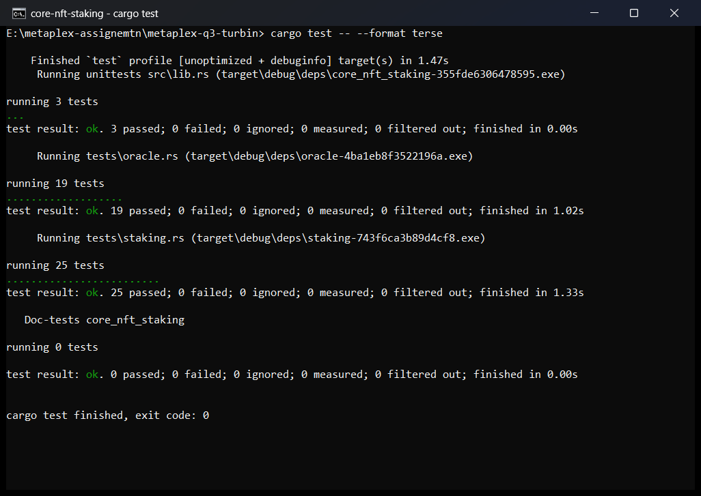

# Core NFT Staking

*Turbin3 Q3 2026 · Week 5 assignment (Metaplex)*

An [Anchor](https://www.anchor-lang.com) 1.2 program that stakes **Metaplex Core** NFTs *in place*: the NFT never leaves the owner's wallet, it is frozen by a Core plugin whose authority is a program PDA. On top of the basic stake / unstake loop it adds:

| | Feature | Core building block |
|---|---|---|
| 1 | **Claim rewards without unstaking** | reward checkpoint on the stake PDA, `mint_to` into the user's ATA |
| 2 | **Burn-to-earn** | `BurnDelegate` plugin (+ `FreezeDelegate` thaw) |
| 3 | **Collection-level stats** | `Attributes` plugin on the **Collection** account (`total_staked`) |
| 4 | **Time-gated transfers** (09:00-17:00 UTC) | **Oracle** external plugin adapter + permissionless, rewarded crank |

> **Where this comes from.** I could not find an existing Core staking program (the course's
> [`NFT-staking`](https://github.com/ASCorreia/NFT-staking) targets Token Metadata), so this is written from scratch. It keeps that
> program's shape (`StakeConfig` / `UserAccount` / `StakeAccount`, a PDA-owned rewards mint) and replaces the Token Metadata
> freeze/thaw CPIs with MPL Core plugins.

**47 tests, all green** (`cargo test`): see [Test results](#test-results). They run the program inside
[LiteSVM](https://github.com/LiteSVM/litesvm) next to the **real MPL Core binary** dumped from mainnet, so every plugin rule that
matters (freeze, burn, plugin authority, Oracle validation) is enforced by Core itself, not by a mock.

---

## How it works

### Accounts

```
                  ┌──────────────────────────── MPL Core ────────────────────────────┐
                  │  Collection  ── Attributes plugin { total_staked }               │
                  │      │            authority = config PDA                         │
                  │      │       ── Oracle adapter (Transfer: CAN_REJECT) ─────────┐ │
                  │      ▼                                                         │ │
                  │  Asset (owner = user's wallet, never moved)                    │ │
                  │      ├─ FreezeDelegate { frozen }   authority = stake PDA      │ │
                  │      └─ BurnDelegate                authority = stake PDA      │ │
                  └────────────────────────────────────────────────────────────────┼─┘
                                                                                   │ reads verdict
 StakeConfig  [config, collection]      ◄── mint authority of rewards mint         ▼
 UserAccount  [user, config, wallet]        Oracle  [oracle, config] ◄── update_oracle (crank)
 StakeAccount [stake, asset, config]        Vault   [vault, config]  ──► pays the cranker
 Rewards mint [rewards, config]
```

| PDA | Seeds | Holds / does |
|---|---|---|
| `StakeConfig` | `["config", collection]` | admin, collection, `reward_per_second`, `burn_bonus`, `freeze_period`, `max_stake`. **Mint authority** of the rewards mint and **plugin authority** of the collection's `Attributes` |
| Rewards mint | `["rewards", config]` | SPL token, 6 decimals |
| `UserAccount` | `["user", config, wallet]` | how many NFTs the wallet has staked (for `max_stake`) |
| `StakeAccount` | `["stake", asset, config]` | owner, asset, `staked_at`, `last_claim_at`. **Plugin authority** of the asset's `FreezeDelegate` and `BurnDelegate` |
| `Oracle` | `["oracle", config]` | the `Transfer` verdict MPL Core reads, crank reward and window |
| Vault | `["vault", config]` | system-owned PDA holding the lamports that pay crankers |

Why the authorities are split this way: the **stake PDA** is per-NFT and disappears when the NFT leaves the pool, so its authority
over that asset ends with it. The **config PDA** is global to the pool, which is what the collection counter and the mint need.
Nobody holds a private key for either, so *only this program's code paths can freeze, thaw, burn or move the counter*.

### Instructions

| Instruction | Who | What it does |
|---|---|---|
| `initialize_config(reward_per_second, burn_bonus, freeze_period, max_stake)` | collection update authority | Creates the pool + rewards mint, adds the `Attributes { total_staked: "0" }` plugin to the collection, with the config PDA as its authority |
| `initialize_user` | any wallet | Creates the wallet's `UserAccount` |
| `stake` | asset owner | Adds `FreezeDelegate(frozen)` and `BurnDelegate` (authority = stake PDA), `total_staked += 1` |
| **`claim_rewards`** | stake owner | Mints `(now - last_claim_at) × reward_per_second` to the user's ATA, moves the checkpoint. **Does not touch the NFT** |
| `unstake` | stake owner, after `freeze_period` | Pays pending rewards, thaws, removes both delegates, `total_staked -= 1`, closes the stake PDA |
| **`burn_staked_nft`** | stake owner | Thaws, burns through the `BurnDelegate`, mints pending rewards **+ `burn_bonus`**, `total_staked -= 1`, closes the stake PDA |
| `initialize_oracle(crank_reward, crank_window, vault_funding)` | admin | Creates the Oracle + vault and attaches the Oracle adapter to the collection |
| **`update_oracle`** | **anyone** | Syncs the `Transfer` verdict with the clock; pays the caller if it lands near a boundary |
| `transfer_nft` | asset owner | Transfers an asset with the Oracle account attached as a remaining account |

---

## Task 1: Core plugins

### 1. Claim rewards without unstaking

`claim_rewards` only reads the stake record, mints, and advances `last_claim_at`. The Core asset is not an account of the
instruction's CPIs at all, so it **stays staked and frozen** by construction. `unstake` and `burn_staked_nft` pay out
whatever accrued since the last claim, so nothing is ever paid twice
(`unstake_after_a_claim_pays_only_the_remainder`).

### 2. Burn-to-earn with `BurnDelegate`

`stake` installs a `BurnDelegate` whose authority is the stake PDA. `burn_staked_nft` then:

1. **thaws** the asset (`UpdatePluginV1`, signed by the stake PDA): a frozen asset can't be burned, *not even by its BurnDelegate*;
2. **burns** it with `BurnV1` where the **authority is the stake PDA** (a real delegated burn, the user is only the payer);
3. mints `pending + burn_bonus` to the user's ATA, decrements `total_staked`, closes the stake PDA.

The burn deliberately does **not** wait for `freeze_period`: the bonus is the price for permanently destroying the NFT, so the
user may take it whenever they want. Only the stake owner can trigger it.

### 3. Collection-level stats (`Attributes` on the Collection)

`initialize_config` adds an `Attributes` plugin with `total_staked = "0"` **to the Collection account** and sets its authority
to the config PDA. `stake` increments it and `unstake` / `burn_staked_nft` decrement it, rewriting the attribute list through
`UpdateCollectionPluginV1`, signed by the config PDA. Because the plugin authority is the PDA, **not even the collection admin
can edit the counter** (`only_the_program_can_touch_the_collection_counter`). Any wallet or marketplace can read the live
number straight from the collection account.

## Task 2: Oracle plugin (time-based transfers)

NFTs may only be transferred **09:00-17:00 UTC**.

* **Oracle account.** `Oracle` is a static PDA whose first field is Core's `OracleValidation`
  (`V1 { create, transfer, burn, update }`, each `Approved | Rejected | Pass`). The adapter is configured with
  `ValidationResultsOffset::Anchor`, so Core reads the verdict right after the 8-byte Anchor discriminator.
  `create`, `burn` and `update` stay `Pass`; only `transfer` is policed. (The enums are mirrored in
  [`state/oracle.rs`](programs/core-nft-staking/src/state/oracle.rs) with the identical Borsh layout because `mpl-core`'s own
  Anchor integration still targets Anchor 0.31/0.32.)
* **Adapter on the collection.** `initialize_oracle` attaches `Oracle { base_address: <oracle PDA>, lifecycle_checks:
  [(Transfer, CAN_REJECT)] }` to the collection. An Oracle adapter may *only* reject (Core has a dedicated
  `OracleCanRejectOnly` error), and because it lives on the **collection**, every asset in it is covered.
* **Permissionless crank.** `update_oracle` reads `Clock`, computes the verdict (`Approved` in `[09:00, 17:00)`, else `Rejected`)
  and writes it. No signer restriction.
* **Crank reward.** The vault pays `crank_reward` lamports **only if the call flips the verdict AND lands within `crank_window`
  seconds after the 09:00 / 17:00 boundary**. A late crank still fixes the state but earns nothing, and a no-op crank earns
  nothing, so there is nothing to farm by spamming. The payout is capped by what the vault holds *above its rent-exempt
  reserve* (the vault is a plain system account and must stay rent-exempt). Anyone can top it up with a normal SOL transfer.
* **Transfer.** `transfer_nft` CPIs `TransferV1` with the Oracle account as a **remaining account**. Outside the window Core
  aborts the transaction.

**Enforcement is in MPL Core, not in this program**: a raw Core `TransferV1` that skips `transfer_nft` is still rejected when the
oracle says `Rejected`, and is rejected as well when the Oracle account is not attached
(`bypassing_our_program_does_not_bypass_the_oracle`).

> **Trade-off worth knowing.** Core cannot read the clock; it only reads the Oracle account. The verdict is therefore exactly as
> fresh as the last crank: if nobody cranks at 17:00, transfers stay open until someone does
> (`the_verdict_is_only_as_fresh_as_the_last_crank` pins this down). That is precisely why the crank is paid.

---

## Build & test

**Tested with:** Rust 1.92, Agave/Solana CLI 4.2.0 (platform-tools v1.54), Anchor 1.2. No validator, Node or Surfpool needed.

```bash
cargo build-sbf      # -> target/deploy/core_nft_staking.so
cargo test           # 47 tests: 3 unit + 25 staking + 19 oracle
```

The first build takes a few minutes (Core + Anchor + LiteSVM). `cargo test` loads the freshly built
`target/deploy/core_nft_staking.so` (the default SBPF v0 build), and the MPL Core program committed under
[`tests/fixtures/`](programs/core-nft-staking/tests/fixtures/README.md) (hash and mainnet slot recorded there).

**With the Anchor CLI** (also verified; it additionally writes the IDL to `target/idl/`):

```bash
anchor build --tools-version v1.54 --arch v0
```

Anchor 1.2's defaults are platform-tools `v1.57` and SBPF `v3`; the flags above match the toolchain and the SBPF v0 build the tests
load. If you have newer platform-tools, adjust or drop them. A checked-in copy of the IDL lives in [`idl/`](idl/core_nft_staking.json).
`Anchor.toml` has no `[toolchain]` section on purpose: the Anchor CLI uses that section to install and *switch your global*
Solana/Anchor versions.

### Test results



*Screenshot of a console running `cargo test -- --format terse` (compact output so it fits one screen): 3 + 25 + 19
= **47 passed, 0 failed**, exit code 0. The full per-test listing is in [`docs/cargo-test-output.txt`](docs/cargo-test-output.txt).*

### What the tests prove

`tests/staking.rs`: Task 1

| Area | Tests |
|---|---|
| Pool setup | `total_staked` attribute is created on the collection, owned by the config PDA · only the collection authority can initialise · a collection that already has an `Attributes` plugin is refused |
| Stake | freezes in place + installs both delegates + `total_staked` +1 · wrong owner / wrong collection / fake asset account / over `max_stake` / double stake rejected |
| Freeze integrity | owner **cannot** transfer, thaw, strip a plugin from, or burn a staked NFT (exact Core errors asserted) · **control test:** the very same raw Core instructions succeed when the owner holds the authority, so the rejections are not malformed-instruction artifacts |
| Claim | mints into the ATA · NFT stays frozen, owned, staked · pays only the time since the last claim · owner-only · nothing-to-claim |
| Unstake | blocked before `freeze_period` · thaws, pays out, removes delegates, closes the stake PDA, NFT transferable again · pays only the remainder after a claim · can restake · owner-only |
| Burn-to-earn | asset account destroyed · pays accrued + `burn_bonus` · allowed before the freeze period · owner-only · impossible once unstaked |
| Collection stats | `total_staked` stays correct across stake / claim / unstake / burn and several users · the admin can't forge it |

`tests/oracle.rs`: Task 2

| Area | Tests |
|---|---|
| Setup | adapter attached with `Anchor` offset, vault funded · admin-only · no double init · crank window validated |
| The window | blocked while `Rejected` (asset not frozen, so the oracle is the cause) · crank at 09:01 opens · crank at 17:01 closes · repeats daily · stale-oracle behaviour documented · a staked NFT stays frozen even when the window is open |
| Enforcement | raw Core transfers can't bypass the oracle (attached-and-rejected, and not-attached) · staking, claiming and burning still work at night |
| Crank reward | paid right after a boundary (exact edge of the window) · late crank fixes state but pays 0 · no-op crank pays 0 · crank near midnight pays 0 · rent reserve preserved, payout capped · works with an unfunded vault |

`src/state/oracle.rs` (unit): verdict flips exactly at 09:00:00 / 17:00:00, repeats daily, handles pre-epoch timestamps, and the
boundary-distance math.

### Compute units (measured in LiteSVM)

| `stake` | `claim_rewards` (incl. ATA creation) | `unstake` | `burn_staked_nft` | `initialize_oracle` | `update_oracle` | `transfer_nft` |
|---|---|---|---|---|---|---|
| 63,157 | 48,864 | 81,672 | 69,930 | 30,617 | 11,594 | 17,913 |

All comfortably under the 200k default budget.

---

## Design notes

* **No escrow.** The NFT stays in the owner's wallet; freezing is a `FreezeDelegate` whose authority is the stake PDA. The user
  can still see it, and Core itself blocks transfer / burn / plugin removal while it is frozen.
* **Everything is validated before it is trusted.** `asset` and `collection` are `UncheckedAccount`s (the `mpl-core` Anchor
  integration is not usable with Anchor 1.x), so the program checks they are owned by MPL Core, carry the right `Key`, that the
  asset's `update_authority` is *this* collection and that its `owner` is the signer.
* **Unstake cleans up.** After thawing, the owner removes both delegate plugins, so a returned NFT is indistinguishable from one
  that was never staked.
* **Pool-per-collection.** All PDAs are keyed by the collection, so one deployment serves many collections.
* **Constraints of the collection `Attributes` plugin.** `initialize_config` fails if the collection already has an `Attributes`
  plugin, and afterwards only the program can edit it. Put extra collection attributes in place *before* handing the pool its
  counter or extend `update_total_staked`.

## Deploying to devnet

Not done as part of this submission (the tests run against the real Core binary locally). To deploy:

```bash
solana config set --url devnet && solana airdrop 2
anchor keys sync            # make declare_id! match your program keypair
anchor build
anchor deploy --provider.cluster devnet
```

Then create a Core collection, call `initialize_config` as its update authority, and `initialize_oracle` if you want the
time-gated transfers.

## Layout

```
metaplex-q3-turbin/
├── Anchor.toml
├── Cargo.toml
├── docs/tests-passing.png
├── idl/core_nft_staking.json       Anchor IDL
└── programs/core-nft-staking/
    ├── src/
    │   ├── lib.rs                  instruction entrypoints
    │   ├── constants.rs  errors.rs  utils.rs
    │   ├── state/                  StakeConfig, UserAccount, StakeAccount, Oracle (+ window math & unit tests)
    │   └── instructions/           one file per instruction
    └── tests/
        ├── common/mod.rs           LiteSVM harness (real MPL Core, clock control, builders, readers)
        ├── staking.rs              Task 1 (25 tests)
        ├── oracle.rs               Task 2 (19 tests)
        └── fixtures/mpl_core.so    MPL Core, dumped from mainnet
```
